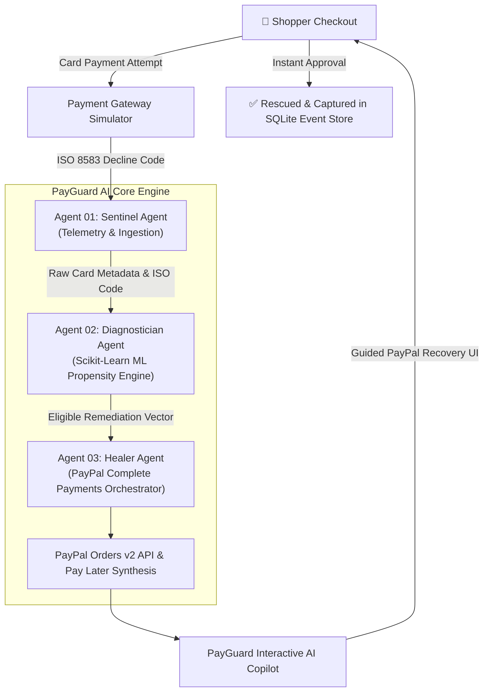

# PayGuard AI 🛡️💳
> **Autonomous Payment Orchestration & Guided Tender Recovery**  
> Built for the **PayPal AI Hackathon ($67,500)** on Devpost.

[](LICENSE)
[](https://www.python.org/)
[](https://developer.paypal.com/)
[](https://scikit-learn.org/)
[](https://sqlite.org)

---

## 💡 The Problem: The $260 Billion Checkout Failure Void

According to research aggregated by the **Baymard Institute (49 independent studies)**, the average e-commerce **cart abandonment rate stands at 70.19%**. Payment friction, card declines, and confusing gateway errors are consistently cited among the top drivers of lost sales.

While payment gateways (Stripe, Adyen, CyberSource) have sophisticated backend network retries to recover soft declines behind the scenes, once an issuing bank returns a hard or threshold decline, traditional checkout flows leave shoppers at a dead end:

> *"Card Declined. Please use another payment method."*

Most shoppers simply abandon the purchase.

**PayGuard AI** bridges this gap through **guided front-end tender switching**. Instead of retrying an already-rejected card, PayGuard AI intercepts the failure at the presentation layer, parses the failure telemetry, and provides a collaborative, consented transition to an optimal **PayPal Complete Payments** tender.

---

## 🧠 Multi-Agent Diagnostic Pipeline & ML Propensity Engine



### The 3 Core Agents:
1. **Sentinel Agent (Telemetry & Ingestion):**
   - Intercepts raw ISO 8583 banking response codes (`51: NSF / Liquidity`, `59: Suspected Fraud`, `82: Currency Mismatch`, `91: Interchange Latency`).
   - Extracts failure category, BIN metadata, and session velocity (measured locally in under 20ms).
2. **Diagnostician Agent (Scikit-Learn ML Propensity Engine):**
   - Implements a trained multiclass Logistic Regression model (`backend/train_model.py`) that evaluates feature vectors:
     `[Normalized Amount, Is_Liquidity, Is_Fraud, Is_FX, Is_Timeout, Session_Velocity]`.
   - Generates conversion likelihoods across 4 PayPal products:
     * `PAYPAL_PAY_LATER` (Pay in 4: 0% interest, no late fees, for eligible $30–$1,500 orders)
     * `PAYPAL_VERIFIED_WALLET` (Biometric / 2FA authenticated wallet)
     * `PAYPAL_DYNAMIC_FX` (Real-time local currency settlement)
     * `PAYPAL_FASTLANE` (Accelerated 1-tap guest checkout)
   - **Eligibility Verification:** If a cart is outside PayPal Pay in 4 bounds (<$30 or >$1,500), it automatically falls back to Verified Wallet or Bank Debit.
3. **Healer Agent (PayPal Orders v2 Synthesizer):**
   - Constructs production-compliant PayPal Orders v2 payloads adhering to official REST specifications.
   - Formulates dynamic installment schedules and feeds the real-time Shopper Copilot.

> **Note on Training Data:**  
> In development, the ML model is trained on synthetic transaction records generated from domain-documented payment heuristics (`backend/train_model.py`). In a production deployment, this model would be retrained on real merchant transaction outcome logs (conversion rates, dispute rates, and customer acceptance per tender).

---

## 🛡️ Responsible AI, Compliance & Buyer Protection

- **No Predatory Credit:** PayPal Pay in 4 is an interest-free installment product with 0% APR and no sign-up fees or late penalties. It breaks temporary liquidity limits on eligible carts without revolving credit charges.
- **No Brute-Forced Cards:** For suspected fraud flags (Code 59), PayGuard AI does *not* retry the blocked card. It transitions the shopper to **PayPal Verified Wallet**, requiring independent 2FA or biometric authentication. Transactions meeting PayPal Seller Protection criteria shift fraud dispute liability to PayPal.
- **Consumer Consent First:** The shopper explicitly reviews the installment schedule or currency terms before confirming payment.

---

## 🚀 Key Platform Views

### 1. 🛒 Shopper Checkout & AI Copilot Experience
- **Interactive Decline Simulator:** Toggle 4 realistic banking decline scenarios live.
- **Real-Time Agent Deliberation:** Transparent step-by-step diagnostic trace.
- **Pay in 4 Installment Calculator:** Dynamically calculates 4 equal bi-weekly payments for eligible amounts.
- **Conversational Shopper Copilot:** Contextual NLP chat assistant with FAQ quick pills (*"Any interest or fees?"*, *"Why did it decline?"*, *"Is my purchase protected?"*).

### 2. 📊 Merchant AI Operations War Room
- **Live Revenue Tickers:** Real-time Rescued GMV, Recovery Rate (%), and Rescued Carts.
- **Interactive Visualizations (Chart.js):**
  - Doughnut chart of ingested decline signatures.
  - Bar chart of recovered orders by PayPal product.
- **Live SQLite Event Audit Stream:** Complete transaction log tracking timestamps, customers, amounts, decline codes, strategies, and execution latencies.

### 3. 🧠 Neural Architecture Visualizer
- Deep-dive inspection into the 3-agent pipeline and the Remediation Strategy Decision Matrix.

---

## 🏃 Quick Start

### 1. Clone & Enter Repository
```bash
git clone https://github.com/kpunia306/payguard-ai.git
cd payguard-ai
```

### 2. (Optional) Retrain ML Model
```bash
cd backend
python3 train_model.py
```

### 3. Launch the Platform
```bash
python3 server.py
```
*Platform starts at `http://localhost:5055`.*

### 4. Open in Browser
Open `http://localhost:5055` in Google Chrome or Safari to test the live checkout, AI reasoning stream, and Merchant War Room!

---

## 📡 REST Endpoints

| Method | Endpoint | Description |
|---|---|---|
| `POST` | `/api/checkout` | Simulates ISO 8583 banking decline & triggers 3-agent diagnosis |
| `POST` | `/api/paypal/create-order` | Synthesizes compliant PayPal Orders v2 JSON object |
| `POST` | `/api/paypal/capture-order` | Captures order, updates SQLite database, and recalculates lift |
| `GET` | `/api/merchant/analytics` | Returns real-time GMV metrics, charts data, and audit feed |
| `POST` | `/api/copilot/chat` | Contextual NLP assistant answering checkout questions |

---

## 🏆 Hackathon Details
- **Hackathon:** PayPal AI Hackathon (Devpost)
- **Author:** Krish Punia ([@kpunia306](https://github.com/kpunia306))
- **Track:** AI Agents & Intelligent Commerce
- **License:** MIT
