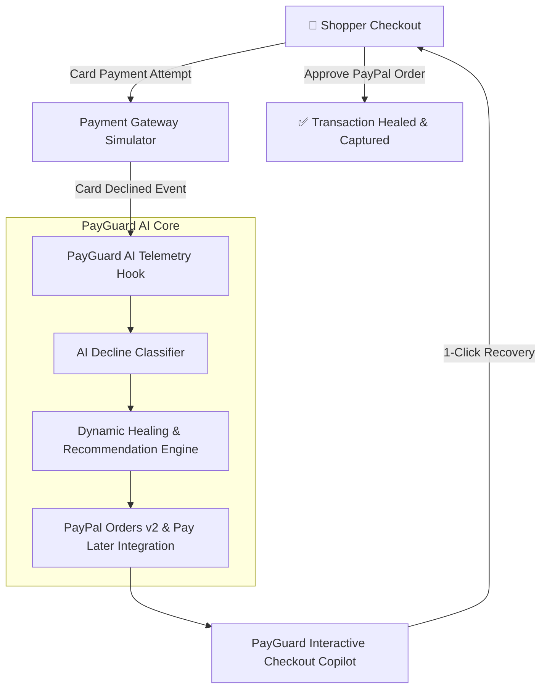

# PayGuard AI 🛡️💳
> Autonomous AI Checkout Recovery & Intelligent Transaction Healing powered by PayPal Complete Payments.

[](LICENSE)
[](https://www.python.org/)
[](https://developer.paypal.com/)
[](https://devpost.com)

---

## 🚀 Overview

Global e-commerce loses over **$260 Billion** annually to checkout friction and payment declines. When a customer's credit card fails due to insufficient funds, strict fraud heuristics, or international card restrictions, traditional gateways present a cold, unhelpful error: *"Card Declined. Try Another Card."* 

Result? **Over 70% of shoppers abandon their cart immediately.**

**PayGuard AI** turns transaction failures into instant revenue recovery. Acting as an intelligent payment orchestration agent directly within the checkout flow:
1. **Intercepts Gate Failures in Real-Time:** Classifies decline reasons (`INSUFFICIENT_FUNDS`, `SUSPECTED_FRAUD`, `CURRENCY_MISMATCH`, `TECHNICAL_TIMEOUT`) via intelligent telemetry.
2. **Dynamic AI Remediation:** Computes the optimal recovery path and presents tailored payment solutions:
   - For `INSUFFICIENT_FUNDS` ➡️ Recommends **PayPal Pay in 4 / Pay Later** installments.
   - For `SUSPECTED_FRAUD` / `3DS_FAILURE` ➡️ Triggers **PayPal One-Touch Biometric Wallet** with buyer protection.
   - For `CURRENCY_MISMATCH` ➡️ Offers **PayPal Multi-Currency Dynamic FX Conversion**.
3. **Autonomous Copilot Guidance:** Shoppers interact with an embedded AI payment assistant that answers security questions and completes order recovery in under 30 seconds.

---

## 🛠️ System Architecture



---

## ✨ Features

- **Multi-Scenario Recovery Simulator:** Test `Insufficient Funds`, `False-Positive Fraud`, and `Cross-Border Currency Mismatch` declines live.
- **PayPal Complete Payments & Pay Later:** Pre-configured mock and live sandbox PayPal API integration for orders, authorization, and capture.
- **Embedded AI Payment Assistant:** Real-time chat copilot that explains errors gently and guides shoppers through the recovery options.
- **Live Recovery Telemetry Dashboard:** Tracks recovered gross merchandise value (GMV), conversion uplift rate, and average resolution time.

---

## 🏃 Quick Start

### 1. Clone the repository
```bash
git clone https://github.com/kpunia306/payguard-ai.git
cd payguard-ai
```

### 2. Install dependencies & run backend
```bash
cd backend
python3 server.py
```
*The server will start at `http://localhost:5050`.*

### 3. Open the checkout simulator
Open `http://localhost:5050` in any web browser to test the interactive checkout experience and AI recovery flows.

---

## 📡 API Endpoints

| Method | Endpoint | Description |
|---|---|---|
| `POST` | `/api/checkout` | Simulates standard card checkout and triggers decline scenarios |
| `POST` | `/api/paypal/create-recovery-order` | Generates PayPal Order ID with Pay Later options |
| `POST` | `/api/paypal/capture-recovery-order` | Captures healed order and updates merchant metrics |
| `GET` | `/api/metrics` | Fetches live recovered revenue and success rate telemetry |

---

## 🏆 Hackathon Details
- **Hackathon:** PayPal AI Hackathon (Devpost)
- **Developer:** Krish Punia ([@kpunia306](https://github.com/kpunia306))
- **License:** MIT
